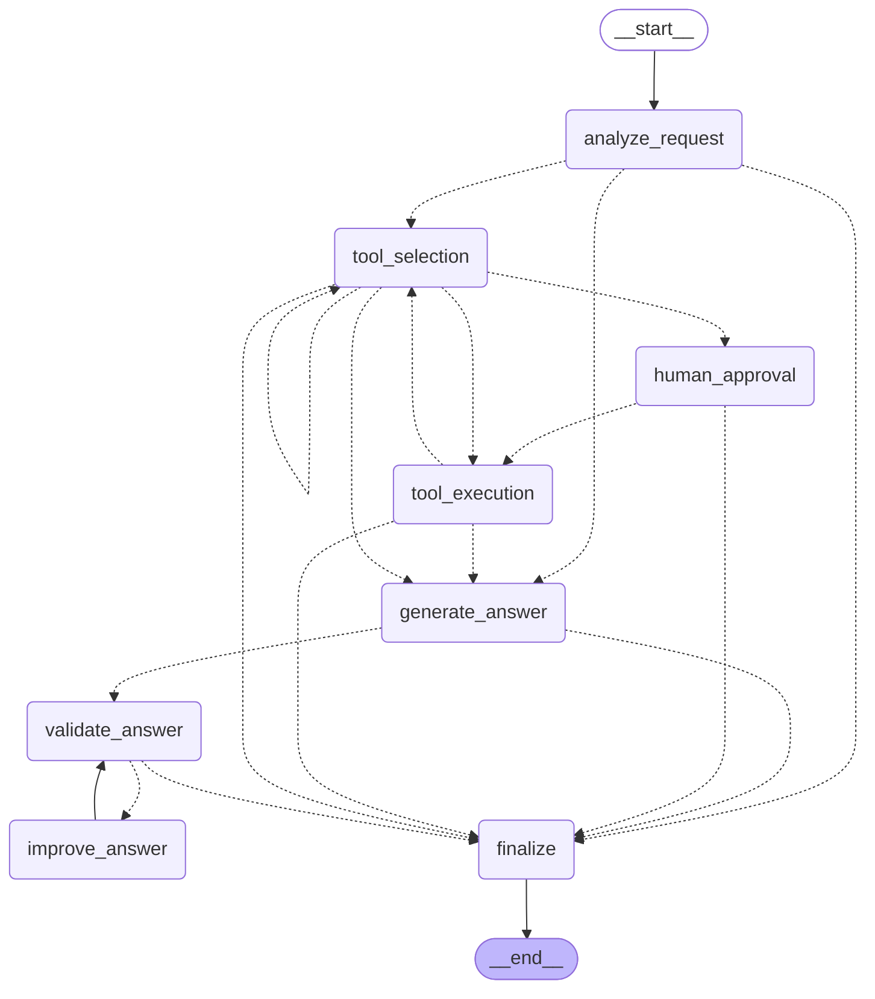

# QueryPilot

AI-агент «SQL-аналитик» на **LangGraph**. Пользователь задаёт вопрос на естественном языке («Какие 3 страны с наибольшим числом клиентов?»), агент смотрит схему БД, пишет SQL, выполняет его, формирует ответ и проверяет, что числа в ответе действительно взяты из результата запроса. Запросы, которые меняют данные (`INSERT` / `UPDATE` / `DELETE`), приостанавливают workflow и ждут подтверждения человека.

Учебный проект: главная цель — освоить построение AI-workflow в виде графа состояний (StateGraph, conditional edges, циклы, human-in-the-loop, тестирование агентов без реальной LLM).

## Возможности

- **Граф состояний** с условными переходами и двумя циклами:
  - *самокоррекция SQL*: запрос упал, отклонён валидатором или вернул «тихо неверный» результат (колонка из одних `NULL`) → ошибка возвращается модели, она переписывает запрос;
  - *улучшение ответа*: в ответе есть число, которого нет в результате запроса (или иероглифы вместо русского) → `improve_answer` переписывает ответ.
- **Лимит итераций** (`MAX_ITERATIONS`, по умолчанию 3): после него workflow корректно завершается со статусом `max_iterations`.
- **Human-in-the-loop**: изменение данных ставит граф на паузу (`waiting_for_approval`) через `interrupt()`; пользователь подтверждает или отклоняет запрос. Пауза хранится в SQLite-чекпоинтах и переживает перезапуск сервера.
- **Безопасность SQL**: статическая проверка через `sqlglot` (один statement; `DROP`/`ALTER`/`PRAGMA` и т. п. запрещены), чтение идёт через read-only соединение, запись разрешена только после подтверждения.
- **История выполнения** в SQLite: вопрос, последовательность nodes, tools, SQL, результат, итерации, ответ, время.
- **HTTP API** на FastAPI и CLI.
- **Два локальных LLM-backend'а**: Ollama (по умолчанию) и llama.cpp (`llama-server`). Платные API не используются.

## Технологии

Python 3.12, LangGraph, LangChain (`langchain-ollama`), Ollama / llama.cpp, FastAPI, Pydantic (+ pydantic-settings), sqlglot, SQLite, httpx, pytest, logging. Менеджер пакетов — [uv](https://docs.astral.sh/uv/).

> Не реализовано: Docker/Compose, PostgreSQL (история и чекпоинты пока в SQLite), таймаут на подтверждение.

## Установка

```bash
git clone <repo> && cd querypilot
uv sync
uv run querypilot seed        # создать демо-БД data/demo.db (клиенты и заказы)
```

### LLM: вариант 1 — Ollama (по умолчанию)

1. Установить Ollama: <https://ollama.com/download> (Windows: `winget install Ollama.Ollama`).
2. Скачать модель и проверить её:

```bash
ollama pull qwen2.5:7b
ollama run qwen2.5:7b "Скажи привет одним словом"
```

Используемая модель — **Qwen2.5-7B-Instruct** (в Ollama тег `qwen2.5:7b`, 4-битная квантизация, около 4,7 ГБ; помещается в 6 ГБ видеопамяти). Ollama слушает `http://localhost:11434`.

### LLM: вариант 2 — llama.cpp

Нужен `llama-server` ([релизы llama.cpp](https://github.com/ggml-org/llama.cpp/releases), Windows: `winget install ggml.llamacpp`) и GGUF-модель:

```bash
llama-server -hf Qwen/Qwen2.5-7B-Instruct-GGUF:Q4_K_M -ngl 99 -c 8192 --port 8080
```

Переключение backend'а — в `.env` в корне проекта:

```
QUERYPILOT_LLM_BACKEND=llamacpp
QUERYPILOT_LLAMACPP_BASE_URL=http://localhost:8080
```

## Запуск

```bash
uv run querypilot ask "Сколько у нас клиентов?"   # CLI: вопрос → ответ
uv run querypilot serve                            # HTTP API на http://localhost:8000 (Swagger: /docs)
uv run querypilot graph                            # схема графа в формате Mermaid
uv run querypilot seed                             # пересоздать демо-БД
```

CLI при запросе на изменение данных сам спросит `Approve? [y/N]`.

### Настройки

Переменные окружения с префиксом `QUERYPILOT_` или файл `.env`:

| Переменная | По умолчанию | Назначение |
|---|---|---|
| `LLM_BACKEND` | `ollama` | `ollama` или `llamacpp` |
| `OLLAMA_MODEL` / `OLLAMA_BASE_URL` | `qwen2.5:7b` / `http://localhost:11434` | настройки Ollama |
| `LLAMACPP_BASE_URL` | `http://localhost:8080` | адрес `llama-server` |
| `LLM_TIMEOUT` | `120` | таймаут запроса к llama.cpp, сек |
| `MAX_ITERATIONS` | `3` | лимит итераций циклов |
| `MAX_ROWS` | `100` | максимум строк результата |
| `DATA_DB_PATH` | `data/demo.db` | БД, к которой агент пишет запросы |
| `HISTORY_DB_PATH` | `data/history.db` | история запусков |
| `CHECKPOINT_DB_PATH` | `data/checkpoints.db` | чекпоинты LangGraph |
| `LOG_LEVEL` | `INFO` | `DEBUG` дополнительно логирует промпты и ответы LLM |

## API

| Метод | Путь | Описание |
|---|---|---|
| `POST` | `/agent/run` | запустить агента: `{"question": "..."}` |
| `GET` | `/agent/status/{id}` | статус, текущий шаг, число итераций |
| `POST` | `/agent/approve/{id}` | подтвердить приостановленное действие |
| `POST` | `/agent/reject/{id}` | отклонить действие |
| `GET` | `/agent/history/{id}` | полная история запуска |

Запрос синхронный: `POST /agent/run` возвращает ответ, когда агент закончил или встал на подтверждение.

```bash
curl -X POST localhost:8000/agent/run -H "content-type: application/json" \
     -d '{"question": "Удали все отменённые заказы"}'
# {"run_id": "…", "status": "waiting_for_approval", "pending_approval": {"sql": "DELETE FROM orders WHERE status = 'cancelled'", …}}

curl -X POST localhost:8000/agent/approve/<run_id>
```

Статусы: `running`, `waiting_for_approval`, `completed`, `rejected`, `failed`, `max_iterations`. Коды ошибок: `404` — неизвестный `id`, `409` — решение по запуску, который не ждёт подтверждения, `422` — пустой вопрос. Сбой LLM или любого node не приводит к HTTP 500: запуск завершается со статусом `failed` и описанием ошибки.

## State

Определён в [state.py](src/querypilot/state.py) (`AgentState`, `TypedDict`).

| Поле | Назначение |
|---|---|
| `messages` | история сообщений (reducer `add_messages`) |
| `user_question` | исходный вопрос |
| `current_step` | имя последнего выполненного node |
| `tool_result` | результат последнего инструмента (`columns`, `rows`, `row_count`, …) |
| `final_answer` | текущий / итоговый ответ |
| `iterations` | счётчик итераций циклов |
| `max_iterations` | лимит итераций (хранится в state, чтобы роутеры оставались чистыми функциями) |
| `needs_data` | нужен ли доступ к БД |
| `schema_text`, `sql` | схема БД и последний SQL |
| `tool_call` | выбранный инструмент: `name`, `args`, `requires_approval` |
| `error` | последняя ошибка или предупреждение |
| `approval` | решение человека: `approved` / `rejected` |
| `feedback` | замечание к ответу от проверки |
| `status` | `running` → `completed` / `rejected` / `failed` / `max_iterations` |
| `visited_nodes`, `tools_used` | журнал выполнения (reducer `operator.add`) |

## Граф и nodes

| Node | Что делает |
|---|---|
| `analyze_request` | LLM определяет, нужен ли доступ к данным |
| `tool_selection` | выбирает инструмент: сначала `schema_inspector`, затем LLM пишет SQL; `validate_sql` решает, нужно ли подтверждение |
| `human_approval` | `interrupt()` и ожидание `approve` / `reject` |
| `tool_execution` | выполняет инструмент, ловит `ToolError`, проверяет результат на колонки из одних `NULL` |
| `generate_answer` | формирует ответ по результату запроса |
| `validate_answer` | детерминированная проверка: числа есть в результате, нет китайских иероглифов, ответ не пустой |
| `improve_answer` | переписывает ответ с учётом замечания (цикл с `validate_answer`) |
| `finalize` | итоговый статус и ответ |

Любое необработанное исключение в node превращается в `status=failed` и ведёт в `finalize`, а не роняет граф. Условные переходы — чистые функции в [routers.py](src/querypilot/routers.py).



Пунктир — условные переходы. Циклы: `tool_selection → tool_execution → tool_selection` (самокоррекция SQL) и `validate_answer → improve_answer → validate_answer` (улучшение ответа). Точки завершения: `finalize → __end__`. Актуальная схема: `uv run querypilot graph` (копия в [docs/graph.md](docs/graph.md)).

## Инструменты

| Инструмент | Файл | Описание |
|---|---|---|
| Schema Inspector | [schema_inspector.py](src/querypilot/tools/schema_inspector.py) | `CREATE`-выражения таблиц и число строк |
| Query Validator | [query_validator.py](src/querypilot/tools/query_validator.py) | статический анализ SQL через `sqlglot`: допустимо ли, меняет ли данные |
| SQL Executor | [sql_executor.py](src/querypilot/tools/sql_executor.py) | выполнение запроса; read-only соединение, пока нет подтверждения |

Проверка ответа ([answer_checker.py](src/querypilot/services/answer_checker.py)) и результата ([result_checker.py](src/querypilot/services/result_checker.py)) — собственная бизнес-логика без LLM.

## Структура проекта

```
src/querypilot/
  api/            FastAPI: приложение и схемы Pydantic
  services/       AgentService, проверки ответа и результата, определение языка
  repositories/   история запусков в SQLite
  tools/          Schema Inspector, Query Validator, SQL Executor
  nodes.py        nodes графа
  routers.py      условные переходы
  graph.py        сборка StateGraph
  state.py        AgentState
  llm.py          Ollama, llama.cpp, FakeLLM для тестов
  config.py       настройки
  bootstrap.py    сборка боевого стека
tests/
  unit/           tools, роутеры, проверки, репозиторий, LLM-адаптеры
  system/         весь граф и HTTP API
```

## Тесты

```bash
uv run pytest
```

Реальная LLM и Ollama не нужны: тесты используют `FakeLLM`, который отдаёт заранее заданные ответы. Системные тесты ([test_workflow.py](tests/system/test_workflow.py), [test_api.py](tests/system/test_api.py)) гоняют настоящий граф и настоящую SQLite:

- полный happy path с проверкой последовательности nodes;
- самокоррекция SQL, отклонение опасного SQL валидатором, «тихо неверный» результат;
- цикл улучшения ответа и остановка по лимиту итераций (для обоих циклов);
- пауза на подтверждение, approve, reject, повторное решение (`409`);
- ошибка инструмента и ошибка LLM → контролируемый статус `failed`;
- пауза переживает «перезапуск сервера» (новый граф и сервис на тех же SQLite-файлах).

## Ограничения

- Проверка ответа ловит выдуманные числа, но не смысловые ошибки в SQL (неверный `JOIN`, неверный фильтр). Качество зависит от модели: 7B-модель иногда усложняет запросы и переходит на китайский язык (для этого есть защита).
- Нет авторизации и многопользовательности; сервис рассчитан на локальный запуск.
- Запросы к API синхронные: ответ приходит после завершения агента.
