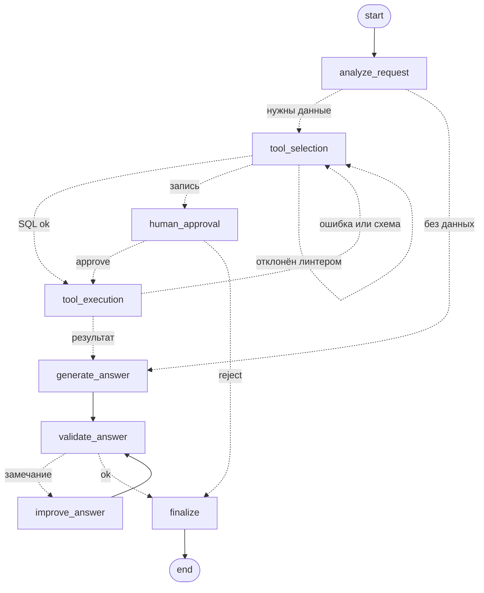

# QueryPilot

AI-агент «SQL-аналитик» на **LangGraph**: вопрос на естественном языке → схема БД → SQL → выполнение → проверенный ответ. Изменение данных ставит граф на паузу до подтверждения человека. Учебный проект: StateGraph, conditional edges, циклы, human-in-the-loop, тесты без реальной LLM.

## Возможности

- **Два цикла** с лимитом `MAX_ITERATIONS=3` (затем статус `max_iterations`): самокоррекция SQL и улучшение ответа.
- **Human-in-the-loop**: `INSERT/UPDATE/DELETE` → `waiting_for_approval` (`interrupt()`). Пауза хранится в SQLite и переживает перезапуск; без решения за `APPROVAL_TIMEOUT_SECONDS` (900) запуск получает `expired`.
- **Проверка SQL до выполнения**: `sqlglot` (один statement, без DDL), read-only соединение и [линтер](src/querypilot/tools/sql_linter.py): JOIN не по внешнему ключу, декартово произведение, колонка вне `GROUP BY`, выдуманные значения фильтров, `= NULL`, `LIMIT` без `ORDER BY`.
- **Проверка ответа**: числа совпадают с результатом запроса, нет иероглифов, язык ответа = язык вопроса; колонка из одних `NULL` → повтор запроса.
- Сбой LLM, инструмента или node → контролируемый `failed`. История запусков в SQLite, FastAPI и CLI, backend'ы Ollama и llama.cpp (платных API нет).

## Технологии

Python 3.12, LangGraph, LangChain, Ollama / llama.cpp, FastAPI, Pydantic, sqlglot, SQLite, pytest, logging, uv, Docker Compose.

## Установка и запуск

```bash
uv sync && uv run querypilot seed        # демо-БД data/demo.db (клиенты, заказы)
```

**Ollama** (по умолчанию): установить с <https://ollama.com/download> (`winget install Ollama.Ollama`), затем `ollama pull qwen2.5:7b`. Модель — **Qwen2.5-7B-Instruct**, 4 бит, около 4,7 ГБ.
**llama.cpp**: `llama-server -hf Qwen/Qwen2.5-7B-Instruct-GGUF:Q4_K_M -ngl 99 -c 8192 --port 8080` и `QUERYPILOT_LLM_BACKEND=llamacpp` в `.env`.

```bash
uv run querypilot ask "Сколько у нас клиентов?"   # CLI, сам спросит подтверждение
uv run querypilot serve                            # API: http://127.0.0.1:8000/docs
uv run querypilot graph                            # схема графа в Mermaid
docker compose up --build                          # Ollama + модель + API
```

Compose поднимает `ollama`, `model-pull` (качает модель) и `api`; GPU: `-f compose.gpu.yaml` (не проверялось). Настройки: переменные `QUERYPILOT_*` или `.env`:

| Переменная | По умолчанию | Назначение |
|---|---|---|
| `LLM_BACKEND` | `ollama` | `ollama` или `llamacpp` |
| `OLLAMA_MODEL`, `OLLAMA_BASE_URL` | `qwen2.5:7b`, `:11434` | Ollama |
| `LLAMACPP_BASE_URL` | `http://localhost:8080` | `llama-server` |
| `MAX_ITERATIONS`, `MAX_ROWS` | `3`, `100` | лимиты |
| `APPROVAL_TIMEOUT_SECONDS` | `900` | `0` — ждать бесконечно |
| `DATA_DB_PATH`, `HISTORY_DB_PATH`, `CHECKPOINT_DB_PATH` | `data/*.db` | БД данных, история, чекпоинты |
| `LOG_LEVEL` | `INFO` | `DEBUG` логирует промпты LLM |

## API

| Метод и путь | Описание |
|---|---|
| `POST /agent/run` | `{"question": "..."}`, ответ приходит синхронно |
| `GET /agent/status/{id}` | статус, шаг, итерации, `approval_expires_at` |
| `POST /agent/approve/{id}`, `/reject/{id}` | решение по приостановленному запросу |
| `GET /agent/history/{id}` | nodes, tools, SQL, результат, итерации, ответ, время |

Статусы: `running`, `waiting_for_approval`, `completed`, `rejected`, `expired`, `failed`, `max_iterations`. Коды: `404` — нет запуска, `409` — запуск не ждёт решения (в том числе истёк), `422` — пустой вопрос.

## State и nodes

`AgentState` ([state.py](src/querypilot/state.py)): `messages`, `user_question`, `current_step`, `tool_result`, `final_answer`, `iterations` (по ТЗ) и расширения: `max_iterations`, `needs_data`, `schema_text`, `sql`, `tool_call`, `error`, `approval`, `feedback`, `status`, `visited_nodes`, `tools_used`.

| Node | Что делает |
|---|---|
| `analyze_request` | LLM решает, нужен ли доступ к БД |
| `tool_selection` | `schema_inspector`, затем LLM пишет SQL; валидатор и линтер проверяют его |
| `human_approval` | `interrupt()`, ждёт `approve` / `reject` |
| `tool_execution` | выполняет инструмент (`ToolError` → повтор), ловит результат из одних `NULL` |
| `generate_answer` | ответ по результату запроса |
| `validate_answer` ⇄ `improve_answer` | детерминированная проверка ответа и его переписывание |
| `finalize` | итоговые статус и ответ |

Условные переходы — чистые функции в [routers.py](src/querypilot/routers.py). Пунктир — условные рёбра, циклы — `tool_selection ⇄ tool_execution` и `validate_answer ⇄ improve_answer`; любая ошибка ведёт в `finalize`. Полная схема: `uv run querypilot graph` или [docs/graph.md](docs/graph.md).



## Тесты

```bash
uv run pytest        # 116 тестов, Ollama не нужен: FakeLLM отдаёт заготовленные ответы
```
`tests/unit` — tools, линтер, роутеры, проверки, репозиторий. `tests/system` — весь граф и API: happy path, оба цикла и лимит итераций, approve / reject / таймаут, ошибки инструмента и LLM, некорректное состояние графа, перезапуск с паузой.